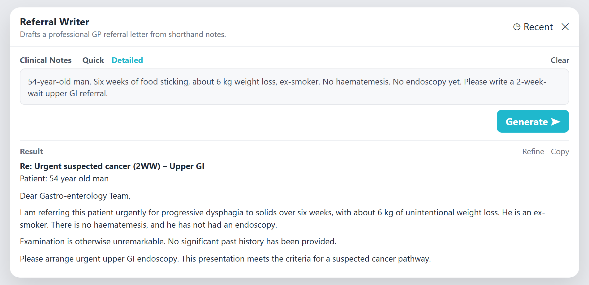
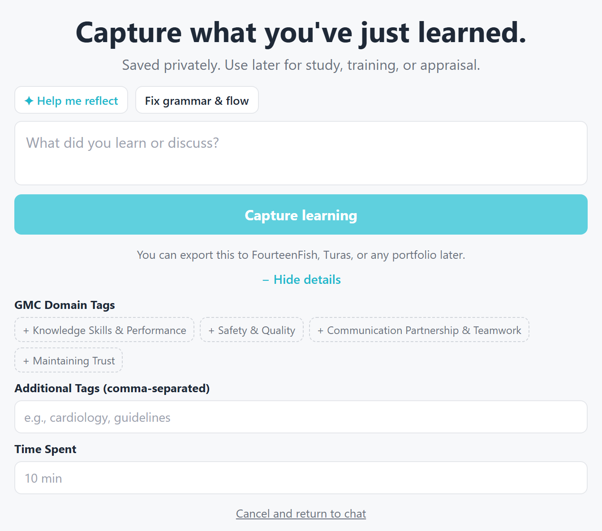
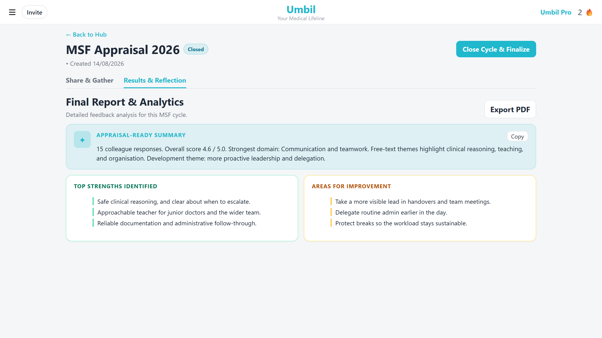
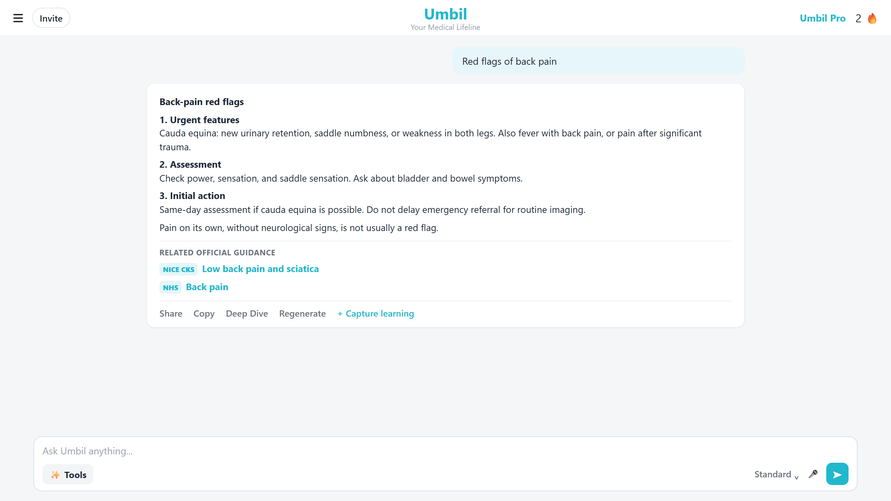

# Umbil

**Your Medical Lifeline** — a UK clinical workflow and learning platform for doctors, trainees, allied health professionals, and medical students.

[](https://nextjs.org/)
[](https://www.typescriptlang.org/)
[](https://supabase.com/)
[](https://expo.dev/)
[](https://vercel.com/)

**Live:** [umbil.co.uk](https://umbil.co.uk) · **Support:** [support@umbil.co.uk](mailto:support@umbil.co.uk)

Ask a clinical question in plain English, draft a referral or safety-net, then capture the learning for appraisal — without leaving the same product.

Umbil is **not a medical device**. Outputs are decision-support drafts. Clinicians remain responsible for every patient decision and must verify doses, pathways, and guidance against authoritative sources (BNF, NICE, SIGN, SmPC) before use.

---

## Contents

- [What Umbil does](#what-umbil-does)
- [Who it is for](#who-it-is-for)
- [Product](#product)
- [Ask modes](#ask-modes)
- [Workflow tools](#workflow-tools)
- [Appraisal and CPD](#appraisal-and-cpd)
- [Architecture](#architecture)
- [Tech stack](#tech-stack)
- [Repository layout](#repository-layout)
- [Getting started](#getting-started)
- [Environment variables](#environment-variables)
- [Scripts](#scripts)
- [Mobile app](#mobile-app)
- [Testing](#testing)
- [Deploy](#deploy)
- [Safety, privacy, and security](#safety-privacy-and-security)
- [Landscape and related work](#landscape-and-related-work)
- [Licence and operator](#licence-and-operator)

---

## What Umbil does

Umbil sits in the gap between a generic chatbot and a hospital EPR. It is built for **UK practice**: NICE/CKS, BNF/BNFC, SIGN, NHS.uk, and named specialty guidance — not US pathways.

| Need | What Umbil provides |
| --- | --- |
| Fast answers in clinic | Clinic / Standard / Deep Dive Ask, streamed, pitched to the clinician’s grade and nation |
| Admin that eats the 10-minute consult | Referral Writer, Digital Triage, Safety Netting, Patient Handout, SBAR, Discharge Letter |
| Appraisal scramble | Capture Learning, GMC-mapped reflections, PDP, anonymised PSQ and MSF |
| Teaching, not just lookup | Deep Dive teaching scaffold (verdict, comparison table, first actions, uncertainty) |

It is a **standalone** web and native app. There is no EMIS or SystmOne integration yet — copy generated text into the clinical system.





---

## Who it is for

- GPs and primary-care teams (referrals, safety-netting, online-message triage)
- Hospital doctors (SBAR, discharge letters, guideline lookup)
- Trainees and medical students (guideline summaries, CPD log, `.ac.uk` Pro)
- Nurses, pharmacists, ANPs, and IMGs working in UK systems
- Training practices that need Team seats for a small multidisciplinary group

---

## Product

### Clinical Ask

Streaming Q&A at `/dashboard`. Answers are UK-English, Markdown, and shaped by question type (lookup, prescribing, acute, diagnostic, chronic, 2WW criteria). Official guidance links are retrieved from a trusted-domain allow-list (NICE, SIGN, BNF, NHS.uk, RCOG, FSRH, BASHH, BTS, and others). Tavily search plus optional RAG (`ENABLE_CHAT_RAG`) supply context; the model is instructed **not to invent guideline codes or a references footer**.

Prescribing questions get extra discipline: product/formulation/licence first, no class-wide risk transfer, GI-bleed + gastroprotection flags, and “not enough UK evidence” as a valid complete answer.

Clinician profile (grade, specialty, UK nation, setting) and a short **Memory** block (role, workplace, exam prep — never patients) change the pitch of the answer, not the safety rules.

### Free and Pro

| | Free | Umbil Pro | Team |
| --- | --- | --- | --- |
| Ask | Monthly caps per mode (Clinic 100, Standard 30, Deep Dive 10) | Unlimited | Pro for up to 10 clinicians |
| Workflow tools | 5 generations / month | Unlimited | Same |
| Capture Learning | 10 logs / month | Unlimited | Same |
| PSQ / MSF / automated PDP | — | Appraisal-ready reports | Same |
| Price | £0 | £14.99/month or £119/year | Contact via Pro page |

Confirmed UK `.ac.uk` student accounts are granted Pro.

Billing is Stripe Checkout + Customer Portal (`/pro`). Web and native checkout are tagged as separate channels.

---

## Ask modes

Defined in `packages/shared/src/constants/chat.ts` and applied in `src/lib/prompts.ts` + `src/app/api/ask/route.ts`.

| Mode | Intended use | Shape |
| --- | --- | --- |
| **Clinic** | Ward / 10-minute consult | Rapid bullets and actions. Low reasoning effort. |
| **Standard** | Everyday lookup | Concise UK answer. One follow-up. |
| **Deep Dive** | Teaching / comparison | Overrides the concise lookup rules. ~400–700 words with Verdict, Why this not that, a comparison table (including UK-licensed products that fit), First actions and safety-netting, Uncertainty or off-label, then one follow-up + Capture learning. |

Deep Dive is injected **last** in the system prompt so ASK_BASE concision cannot win.

---

## Workflow tools

Shared IDs in `packages/shared/src/constants/tools.ts`. Web and mobile both call `POST /api/tools`.

| Tool | Purpose |
| --- | --- |
| **Referral Writer** | Shorthand notes → consultant-ready GP referral (including 2WW) |
| **Digital Triage** | AccuRx / online-message reply with red-flag questions. Screening only. |
| **Safety Netting** | Patient-facing advice and named red flags |
| **Patient Handout** | Printable NHS-style leaflet; multilingual translation |
| **SBAR Handover** | Situation–Background–Assessment–Recommendation for urgent calls |
| **Discharge Letter** | PRSB-aligned discharge from ward notes |

Digital Triage runs extra safety chips (matched templates, detected context, high-risk wording). Patient handouts can be printed from web and from a native Expo print dialog.

---

## Appraisal and CPD

UK doctors spend a large part of the year reconstructing portfolio evidence. Umbil captures it while work is happening.

- **Capture Learning** — one click from an Ask answer into a structured CPD entry, with AI-drafted reflection mapped to GMC Good Medical Practice domains.
- **Learning Log** — search, streaks, freeze weeks, CSV and GMC-domain PDF export.
- **PDP** — personal development plan goals, with automated generation on Pro.
- **PSQ** — Patient Satisfaction Questionnaire cycles, kiosk / QR, anonymised results, appraisal PDF.
- **MSF** — Multi-Source Feedback, clinical vs non-clinical nominators, anonymous aggregation, AI appraisal summary, appraisal PDF.

Public respondent forms live at `/s/[id]` (PSQ) and `/m/[id]` (MSF). Marketing explainers: `/psq-appraisals`, `/msf-appraisals`, `/capture-clinical-learning`.





---

## Architecture

```
                    ┌─────────────────┐     ┌──────────────────┐
                    │  Next.js 15 web │     │  Expo 54 mobile  │
                    │  (App Router)   │     │  (Expo Router)   │
                    └────────┬────────┘     └────────┬─────────┘
                             │  @umbil/shared        │
                             │  types, tools, Ask    │
                             │  modes, API paths     │
                             └──────────┬────────────┘
                                        │
                          HTTPS /api/* (ask, tools, stripe,
                          transcribe, CPD, public PSQ/MSF)
                                        │
                    ┌───────────────────┴────────────────────┐
                    │         Vercel  +  Supabase            │
                    │  Auth · Postgres · pgvector · RLS      │
                    │  OpenAI / Together · Tavily · Stripe   │
                    │  Resend · Vercel Cron                  │
                    └────────────────────────────────────────┘
```

- **Web** owns marketing pages, blog, admin engagement, Stripe webhooks, and the API the app consumes.
- **Mobile** is a native shell over the same Supabase project and `/api/*` backend. Web-only surfaces (landing, admin, public `/s/*` `/m/*` forms) stay in the browser.
- **Do not** put `SUPABASE_SERVICE_KEY`, Stripe secrets, or model keys in client bundles. Mobile uses the **anon** key only.

---

## Tech stack

| Layer | Choice | Why |
| --- | --- | --- |
| Web | Next.js 15 App Router, React 19, Tailwind CSS v4 | Production app + serverless API on one deploy |
| Native | Expo SDK 54, Expo Router, EAS | Same backend; Inter + teal `#1fb8cd` brand |
| Shared | `@umbil/shared` workspace package | Keep tool IDs, Ask modes, and API paths aligned |
| Data / auth | Supabase (PostgreSQL, pgvector, RLS, Auth) | Clinician-owned rows; vector search when RAG is on |
| Ask LLM | OpenAI (`ASK_PROVIDER=openai`, default `gpt-5.6-luna`) with Together fallback | Clinic uses low reasoning; Deep Dive uses a longer teaching prompt |
| Search | Tavily, trusted-domain overlay | Live NICE/SIGN/BNF hits, no invented citations |
| Payments | Stripe Checkout + Customer Portal | Pro monthly/annual and Team |
| Email | Resend | MSF invites, Pro welcome, engagement reports |
| Analytics | Vercel Analytics + `/admin/engagement` | Weekly questions, Ask-mode mix, Stripe revenue |
| PDFs | `@react-pdf/renderer` (web), `expo-print` (app) | Appraisal packs and CPD export |

Comparable production patterns: [nextjs/saas-starter](https://github.com/nextjs/saas-starter) (Next.js + Stripe + auth) and [OpenMed](https://github.com/ianrowan/OpenMed) (Next.js 15 + Supabase RLS + medical AI chat).

---

## Repository layout

```
Umbil/
├── src/app/                 # Next.js App Router (pages + API routes)
│   ├── api/ask              # Streaming clinical Ask
│   ├── api/tools            # Six workflow tools
│   ├── api/stripe           # Checkout, portal, webhooks
│   ├── api/public           # Anonymised PSQ / MSF collection
│   ├── admin/engagement     # Internal product analytics
│   ├── dashboard            # Signed-in / guest Ask
│   ├── cpd, pdp, psq, msf   # Portfolio
│   └── blog, about, pro     # Marketing + content
├── src/lib/                 # Prompts, guardrails, RAG, billing, CPD
├── src/components/          # Web UI (landing, Ask bar, reports)
├── apps/mobile/             # Expo app — see apps/mobile/README.md
├── packages/shared/         # Types, constants, API client
├── supabase/migrations/     # Schema changes applied to the linked project
├── vercel.json              # Monday 07:00 UTC engagement-report cron
└── public/workflow/         # Product screenshots used on landing pages
```

Protected routes (middleware): `/cpd`, `/pdp`, `/profile`, `/settings`, `/psq`, `/msf`. `/dashboard` stays reachable for guest Ask.

---

## Getting started

**Prerequisites:** Node.js 20+, npm, a [Supabase](https://supabase.com/) project, and API keys for the models you intend to run (OpenAI and/or Together, plus Tavily). Stripe and Resend are optional for local Ask/tools work.

```bash
git clone https://github.com/Umbil-CPD-tool/Umbil.git
cd Umbil
npm install
cp .env.example .env.local
```

Fill `.env.local` (see below). Then:

```bash
npm run dev
```

Open [http://localhost:3000](http://localhost:3000). Logged-out visitors see the landing page; `/dashboard` is Ask.

Supabase CLI is a dev dependency. Link the production project only when you intend to apply migrations:

```bash
npx supabase login
npx supabase link --project-ref <project-ref>
npx supabase db push   # only with an explicit migration you mean to ship
```

Do not commit `supabase/.temp/` or service-role keys.

---

## Environment variables

Copy [`.env.example`](./.env.example) to `.env.local`. Never put secrets in client code or `eas.json`.

| Variable | Where | Purpose |
| --- | --- | --- |
| `NEXT_PUBLIC_SUPABASE_URL` | Web | Supabase project URL |
| `NEXT_PUBLIC_SUPABASE_ANON_KEY` | Web | Publishable anon key |
| `SUPABASE_SERVICE_KEY` | Server only | Admin / RLS-bypass (never ship to the browser or Expo) |
| `NEXT_PUBLIC_SITE_URL` | Web | Canonical origin, e.g. `https://umbil.co.uk` (Stripe return URLs) |
| `OPENAI_API_KEY` | Server | Default Ask provider |
| `ASK_PROVIDER` | Server | `openai` (default) or Together |
| `ASK_OPENAI_MODEL` | Server | Default `gpt-5.6-luna` |
| `ASK_REASONING_EFFORT` | Server | Default `low` (Clinic) |
| `TOGETHER_API_KEY` | Server | Tools, transcription, memory, Together Ask fallback |
| `TAVILY_API_KEY` | Server | Live guideline search |
| `ENABLE_CHAT_RAG` | Server | `true` to include vector context |
| `STRIPE_SECRET_KEY` | Server | Checkout, portal, revenue |
| `STRIPE_WEBHOOK_SECRET` | Server | `/api/stripe/webhook` |
| `RESEND_API_KEY` | Server | Transactional email |
| `CRON_SECRET` | Server | Protects `/api/cron/*` |
| `OPENAI_ADMIN_KEY` | Server | Optional model-spend dashboard (Costs read) |
| `ENGAGEMENT_REPORT_TO` | Server | Weekly admin email list |
| `ENGAGEMENT_REPORT_SLACK_WEBHOOK` | Server | Optional Slack copy of that report |

Mobile (`apps/mobile/.env`): `EXPO_PUBLIC_SUPABASE_URL`, `EXPO_PUBLIC_SUPABASE_ANON_KEY`, `EXPO_PUBLIC_API_URL` (`https://umbil.ai` in production).

---

## Scripts

```bash
npm run dev              # Next.js + Turbopack
npm run build            # Production web build
npm run start            # Serve the production build
npm run lint             # ESLint
npm test                 # Node test runner over src/lib/*.test.ts(x)
npm run mobile           # Expo Metro
npm run mobile:tunnel    # Expo with tunnel (when LAN QR fails)
npm run mobile:ios       # iOS
npm run mobile:android   # Android
```

---

## Mobile app

Native iOS/Android in `apps/mobile`, Expo SDK 54, store version 1.0.0. Tagline and brand match web. **No push notifications in v1.** Portrait-locked; tablets supported.

- Expo Go is enough for layout, login, typed Ask, Learning Log, Tools (no mic), PDP, PSQ/MSF, Settings, dark mode.
- **Dictation requires a development or store build** (`expo-speech-recognition` is not available in Expo Go).

Full runbook, EAS profiles, and the feature-parity checklist: [`apps/mobile/README.md`](./apps/mobile/README.md) and [`apps/mobile/FEATURES.md`](./apps/mobile/FEATURES.md).

---

## Testing

```bash
npm test
```

Coverage is concentrated where mistakes are clinical or financial: prompts/intent, official-guidance allow-list, prescribing guardrails, digital triage, appraisal packs, PSQ analytics, Stripe revenue parsing, security helpers, and student Pro.

Add a sibling `*.test.ts` next to new logic in `src/lib/` and append it to the `test` script in `package.json`.

---

## Deploy

Web is deployed on **Vercel**. Production origin is `https://umbil.co.uk`.

1. Connect `Umbil-CPD-tool/Umbil` to the Vercel project.
2. Set the server env vars from the table above (production Stripe keys, webhook secret, `NEXT_PUBLIC_SITE_URL=https://umbil.co.uk`).
3. Stripe webhook endpoint: `https://umbil.co.uk/api/stripe/webhook`.
4. `vercel.json` schedules `/api/cron/engagement-report` at `0 7 * * 1`. Protect it with `CRON_SECRET`.

Mobile store binaries: `eas build --profile production` then `eas submit`, documented in the mobile README. Privacy URL for stores: `https://umbil.ai/privacy`.

---

## Safety, privacy, and security

Follow the same bar as research clinical-AI repos such as [ATHENA-R1](https://github.com/mims-harvard/ATHENA) and [Clinical-Assistant](https://github.com/makidav/clinical-assistant): **software quality is not a clinical performance claim.**

- Not for diagnosis, treatment, or emergencies. No 999/immediate-care pathway lives in the model.
- **Do not paste patient names, NHS numbers, or other identifiers.** Workflow tools are designed to run on anonymised shorthand. Server-side filters attempt to redact identifiers; the clinician is still responsible.
- PSQ/MSF responses are anonymised. Individual patient or colleague identity is not stored with a submission (date of entry only).
- Security headers in `next.config.ts`: `X-Frame-Options`, `nosniff`, Referrer-Policy, Permissions-Policy (`microphone=(self)` for dictation), and a conservative CSP for plugins/framing.
- Stripe price IDs are mapped **server-side** in `src/lib/stripePrices.ts`. Checkout never trusts a client-supplied price.
- Open redirects are rejected (`safeInternalPath`). MSF invite email is a single recipient, not a list.

Terms: [/terms](https://umbil.co.uk/terms) · Privacy: [/privacy](https://umbil.co.uk/privacy)

---

## Landscape and related work

Umbil is a **production UK clinician product**, not a research benchmark. The GitHub READMEs below are the closest public analogues — used here to document how this repo is shaped, not as dependencies.

### Clinician Q&A products

| Project | What it is | How Umbil differs |
| --- | --- | --- |
| [OpenEvidence](https://www.openevidence.com/) | US clinician search; generative answers grounded in peer-reviewed literature | Umbil is UK-guideline first (NICE/BNF/SIGN), with workflow tools and GMC appraisal attached to the same Ask |
| [AMBOSS](https://www.amboss.com/) | Medical knowledge library + cited AI Mode | Umbil is a thin Ask layer over live UK sources plus documentation generators, not a textbook |
| [Doximity Ask](https://www.doximity.com/) | US-verified clinician Q&A with a thinking mode | Umbil ships Clinic / Standard / Deep Dive in one unauthenticated-capable Ask bar, then Capture Learning |

### Open-source medical AI (stack cousins)

| Project | Stack / idea | What we take from that README pattern |
| --- | --- | --- |
| [OpenMed](https://github.com/ianrowan/OpenMed) | Next.js 15, Supabase RLS, AI chat, Vercel | Same core web stack; Umbil is clinician-workflow not consumer lab-result analysis |
| [nextjs/saas-starter](https://github.com/nextjs/saas-starter) | Next.js, Postgres, Stripe, auth, dashboard | Checkout, Customer Portal, webhook, env-var production checklist |
| [LiveAD](https://github.com/YamaanNandolia/Healthapp) | Next.js 15 + Supabase remote care | Feature table + RLS notes as a README convention |
| [MedMitra](https://github.com/Spyrosigma/Medmitra) | Next.js + Supabase medical case management | Separate frontend env vs server secrets — Umbil keeps service role off Expo |

### Clinical reasoning and NHS workflow research

| Project | Focus | Overlap with Umbil |
| --- | --- | --- |
| [ATHENA-R1](https://github.com/mims-harvard/ATHENA) (Harvard) | Multi-step treatment reasoning over 212 biomedical tools; structured report with caveats | Same “not a medical device” stance; Umbil Deep Dive is a teaching scaffold, not an RL agent |
| [OpenClinicalAI MCP](https://github.com/OpenClinicalAI/clinicalai-mcp) | Open calculators, drugs, evidence, terminologies | Umbil uses Tavily + a UK domain allow-list instead of a public MCP tool universe |
| [PRAXIS](https://github.com/ss1738/Praxis) | NHS GP SOAP from consult audio, SNOMED, NICE checks | Adjacent GP-admin problem; Umbil drafts letters/handovers from typed notes, not consult audio |
| [AuditAI](https://github.com/muhammed-healthai/audit-ai) | NHS-styled audit PDF with NICE/RCP recommendations | Same appraisal-document instinct; Umbil’s PDFs are CPD, PSQ, and MSF packs |
| [Nora / NHS n8n assistant](https://github.com/roger-rkd/nhs-ai-assistant-n8n) | NHS-source RAG, citations required, 999 bypass | Umbil also fail-closed on invented citations; emergency care is explicitly out of scope |
| [Clinical-Assistant](https://github.com/makidav/clinical-assistant) | Verifiable clinical-reasoning skill; DRAFT headers | Umbil’s prompts similarly forbid fake BNF/NICE attributions |
| [Medkit](https://github.com/bedriyan/medkit-app) | OSCE-style AI patients graded against NICE/ESC | Education adjacent; Umbil students use Ask + CPD log rather than a simulator |
| [HealthRex CDSS](https://github.com/HealthRex/CDSS) | Stanford clinical order-recommendation research | Research CDSS; Umbil is a SaaS copilot, not an order-entry model |

**Umbil’s combination that those projects do not ship together:** UK guideline-grounded Ask (three modes) + six copy-paste GP/ward tools + GMC CPD/PSQ/MSF/PDP on web and native, with Stripe Pro/Team.

---

## Licence and operator

This repository is the **private production codebase** for Umbil, operated by **Mastering Medicine Ltd**. It is not an MIT research dump. Do not copy patient data, service-role keys, or Stripe live keys into issues or PRs.

Internal changes go through feature branches and pull requests. Keep clinical terminology, Tailwind v4 styling, and routing discipline as they are. Do not expose `.env` values in client code.

Questions about the live product: [support@umbil.co.uk](mailto:support@umbil.co.uk) · [umbil.co.uk/about](https://umbil.co.uk/about)
